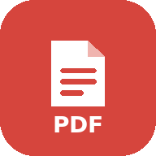

<p align="center"></p>

<h1 align="center">PDF Araçları · PDF Tools</h1>

<p align="center">
  <a href="README.tr.md">Türkçe</a> · <b>English</b><br>
  A free, open-source PDF toolkit that runs entirely in your browser. Your files are never uploaded.<br>
  <a href="https://pdf.sporyazilimlari.com.tr">pdf.sporyazilimlari.com.tr</a>
</p>

---

## What is it?

PDF Tools is a web app that does iLovePDF-style tasks **entirely in the user's browser**.
It has 22 tools: merge, split, compress, convert, sign, read PDFs aloud and more.

- 🔒 **Private:** PDFs never leave the device. The server only delivers the page and its libraries.
- 📱 **PWA:** installs like an app on phones and computers and works offline.
- 🌐 **Bilingual:** Turkish and English (TR / EN switch in the top-right corner).
- 🪶 **Lightweight server:** one Caddy container, ~20–40 MB RAM when idle. TLS certificates are obtained and renewed automatically.

## Tools

| Group | Tools |
|---|---|
| **Read Aloud** | Read PDF Aloud (current sentence highlighted, choose voice/speed/pitch) |
| **Edit** | Merge · Split · Extract Pages · Delete Pages · Organize Pages (reorder/rotate/delete with previews) · Rotate · Compress · Crop |
| **Convert from PDF** | PDF → JPG/PNG · PDF → Word (.docx) · PDF → PowerPoint (.pptx) · PDF → Text (.txt) |
| **Convert to PDF** | JPG/PNG → PDF · Word → PDF · Excel → PDF |
| **Sign & stamp** | Sign (draw or type) · Watermark · Page Numbers |
| **Security** | Protect · Unlock · Repair |

Every tool explained: **[User guide](docs/en/usage.md)**

## Quick install (server)

```bash
# 1) Copy to the server from your computer
scp pdf-sunucu.zip root@SERVER_IP:/opt/

# 2) Unpack and install on the server
ssh root@SERVER_IP
cd /opt && unzip -o pdf-sunucu.zip && cd pdf-sunucu
sudo bash kurulum.sh
```

Or from GitHub:

```bash
git clone https://github.com/purkusur-pixel/pdf.git && cd pdf
cp .env.example .env      # check the domain and e-mail
sudo bash kurulum.sh
```

`kurulum.sh` ("setup") installs Docker if missing, opens ports 80/443 in the firewall, checks DNS,
starts the container and waits until the TLS certificate is issued.
Details and troubleshooting: **[Installation guide](docs/en/installation.md)**

## How it works

```
Browser (phone / computer)                     Server (Docker)
┌──────────────────────────────────┐          ┌───────────────────────────┐
│ index.html + JavaScript          │  HTTPS   │ Caddy                     │
│  • PDF.js  → rendering, text     │◀────────▶│  • static files (html/)   │
│  • pdf-lib → merge, split…       │  page &  │  • automatic Let's Encrypt│
│  • docx, pptxgenjs, mammoth…     │ libraries│  • br/gzip, HTTP/3        │
│  • Web Speech API → read aloud   │   only   │                           │
│  • Service Worker → offline      │          │ PDFs NEVER reach it       │
└──────────────────────────────────┘          └───────────────────────────┘
```

## Project layout

```
├── src/index.html          Source page (single file; also works standalone via CDNs)
├── tools/build.py          Builds src → html/ (local libraries, PWA, precompression)
├── html/                   Published site (built, committed and ready to serve)
├── Caddyfile               Web server + automatic HTTPS
├── Dockerfile              caddy:2.8-alpine image
├── docker-compose.yml      Runs it with resource limits
├── .env.example            DOMAIN and ACME_EMAIL
├── kurulum.sh              One-command server setup / update
├── github-gonder.sh        One-command push to GitHub
├── docs/en, docs/tr        Guides
├── licenses/               Third-party license texts
└── THIRD_PARTY_NOTICES.md  Bundled libraries
```

Development, building and pushing to GitHub: **[Developer guide](docs/en/development.md)**

## Limitations

- **Compress, Protect, Unlock** convert pages to images, so text in the result isn't selectable.
- **PDF → Word** transfers text and paragraphs; complex layouts, tables and images are not kept.
- **Word/Excel → PDF** transfers the content; fonts and layout may differ from Office. Legacy `.doc` isn't supported.
- **Not included:** OCR (scanned documents to text), PDF → Excel, PowerPoint → PDF.
- Read-aloud voices depend on the browser and operating system.

## License

[MIT](LICENSE). Licenses of bundled libraries: [THIRD_PARTY_NOTICES.md](THIRD_PARTY_NOTICES.md).
