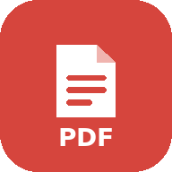

<p align="center"></p>

<h1 align="center">PDF Araçları</h1>

<p align="center">
  <b>Türkçe</b> · <a href="README.md">English</a><br>
  Tarayıcıda çalışan, ücretsiz ve açık kaynak PDF araç seti. Dosyaların hiçbir sunucuya yüklenmez.<br>
  <a href="https://pdf.sporyazilimlari.com.tr">pdf.sporyazilimlari.com.tr</a>
</p>

---

## Bu nedir?

PDF Araçları, iLovePDF benzeri işlemleri **tamamen kullanıcının tarayıcısında** yapan bir web uygulamasıdır.
Birleştirme, bölme, sıkıştırma, dönüştürme, imzalama ve PDF'i sesli okuma gibi 22 araç içerir.

- 🔒 **Gizlilik:** PDF'ler cihazdan çıkmaz. Sunucu yalnızca sayfayı ve kütüphaneleri gönderir.
- 📱 **PWA:** Telefona ve bilgisayara uygulama gibi kurulur, internet olmadan da çalışır.
- 🌐 **İki dil:** Türkçe ve İngilizce (sağ üstteki TR / EN düğmesi).
- 🪶 **Hafif sunucu:** Tek bir Caddy konteyneri; boşta ~20–40 MB RAM. SSL sertifikası otomatik alınır ve yenilenir.

## Araçlar

| Grup | Araçlar |
|---|---|
| **Sesli Oku** | PDF Sesli Oku (okunan cümle vurgulanır, ses/hız/ton seçimi) |
| **Düzenle** | Birleştir · Böl · Sayfa Çıkar · Sayfa Sil · Sayfaları Düzenle (önizlemeli sırala/döndür/sil) · Döndür · Sıkıştır · Kırp |
| **PDF'den dönüştür** | PDF → JPG/PNG · PDF → Word (.docx) · PDF → PowerPoint (.pptx) · PDF → Metin (.txt) |
| **PDF'ye dönüştür** | JPG/PNG → PDF · Word → PDF · Excel → PDF |
| **İmza & işaret** | İmzala (çiz veya yaz) · Filigran · Sayfa Numarası |
| **Güvenlik** | Şifrele · Kilit Aç · Onar |

Her aracın ayrıntılı anlatımı: **[Kullanım kılavuzu](docs/tr/kullanim.md)**

## Hızlı kurulum (sunucu)

```bash
# 1) Bilgisayarından sunucuya gönder
scp pdf-sunucu.zip root@SUNUCU_IP:/opt/

# 2) Sunucuda aç ve kur
ssh root@SUNUCU_IP
cd /opt && unzip -o pdf-sunucu.zip && cd pdf-sunucu
sudo bash kurulum.sh
```

Ya da GitHub'dan:

```bash
git clone https://github.com/purkusur-pixel/pdf.git && cd pdf
cp .env.example .env      # alan adı ve e-postayı kontrol et
sudo bash kurulum.sh
```

`kurulum.sh` Docker'ı (yoksa) kurar, güvenlik duvarında 80/443'ü açar, DNS'i kontrol eder,
konteyneri başlatır ve SSL sertifikası alınana kadar bekler.
Ayrıntılar ve sorun giderme: **[Kurulum kılavuzu](docs/tr/kurulum.md)**

## Nasıl çalışır?

```
Tarayıcı (telefon / bilgisayar)                Sunucu (Docker)
┌──────────────────────────────────┐          ┌───────────────────────────┐
│ index.html + JavaScript          │  HTTPS   │ Caddy                     │
│  • PDF.js  → görüntüleme, metin  │◀────────▶│  • statik dosyalar (html/)│
│  • pdf-lib → birleştir, böl…     │ yalnızca │  • otomatik Let's Encrypt │
│  • docx, pptxgenjs, mammoth…     │ sayfa ve │  • br/gzip, HTTP/3        │
│  • Web Speech API → sesli okuma  │ kütüphane│                           │
│  • Service Worker → çevrimdışı   │          │ PDF'ler buraya GELMEZ     │
└──────────────────────────────────┘          └───────────────────────────┘
```

## Proje yapısı

```
├── src/index.html          Kaynak sayfa (tek dosya; CDN ile tek başına da çalışır)
├── tools/build.py          src → html/ derlemesi (yerel kütüphaneler, PWA, sıkıştırma)
├── html/                   Yayınlanan site (derlenmiş, depoda hazır)
├── Caddyfile               Web sunucusu + otomatik SSL ayarı
├── Dockerfile              caddy:2.8-alpine imajı
├── docker-compose.yml      Kaynak sınırları ile çalıştırma
├── .env.example            DOMAIN ve ACME_EMAIL
├── kurulum.sh              Tek komutla sunucu kurulumu / güncelleme
├── github-gonder.sh        Tek komutla GitHub'a gönderme
├── docs/tr, docs/en        Kılavuzlar
├── licenses/               Üçüncü taraf lisans metinleri
└── THIRD_PARTY_NOTICES.md  Kullanılan kütüphaneler
```

Geliştirme, derleme ve GitHub'a gönderme: **[Geliştirici kılavuzu](docs/tr/gelistirme.md)**

## Sınırlamalar

- **Sıkıştır, Şifrele, Kilit Aç** sayfaları görüntüye çevirir; sonuçta metin seçilemez.
- **PDF → Word** metni ve paragrafları aktarır; karmaşık düzen, tablo ve resimler korunmaz.
- **Word/Excel → PDF** içeriği aktarır; yazı tipleri ve düzen Office ile birebir olmayabilir. Eski `.doc` desteklenmez.
- **Bu araçlar yok:** OCR (taranmış belgeyi metne çevirme), PDF → Excel, PowerPoint → PDF.
- Sesli okumadaki sesler tarayıcıya ve işletim sistemine bağlıdır.

## Lisans

[MIT](LICENSE). Kullanılan kütüphanelerin lisansları: [THIRD_PARTY_NOTICES.md](THIRD_PARTY_NOTICES.md).
